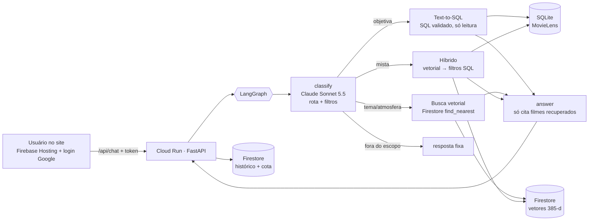

# CineGraph

Chatbot híbrido de recomendação de filmes (PTC3567 · Ciência dos Dados).
Combina **Text-to-SQL** sobre um banco SQLite e **busca semântica** em um banco vetorial (Firestore),
orquestrados por um grafo **LangGraph** que escolhe o mecanismo certo para cada pergunta. Todo filme
mostrado vem do acervo MovieLens, com título, ano e nota lidos do banco, nunca gerados pelo modelo.

Integrantes: Gustavo Jae Min Yu (13782762) · Ian Seo Takose (13680592) · Vinicius Kenji Yamada (13782863)

## Arquitetura



| Peça | Escolha |
|---|---|
| Dados | MovieLens Latest Small (9.742 filmes, 100.836 avaliações, 3.683 tags) |
| Banco relacional | SQLite somente leitura, dentro do container |
| Embeddings | `paraphrase-multilingual-MiniLM-L12-v2` via fastembed (local, gratuito) + dimensão de popularidade |
| Banco vetorial | Firestore Vector Search (cota gratuita), índice `flat`, produto interno |
| LLM | Claude Sonnet 5.5 (`claude-sonnet-5-5`), saídas estruturadas, cache de prompt e fallback do servidor |
| Orquestração | LangGraph 1.x |
| Site | HTML/CSS/JS estático no Firebase Hosting + Firebase Auth (Google) |
| Backend | FastAPI no Cloud Run, atrás do Hosting em `/api/**` |

## Como rodar

Pré-requisitos: [uv](https://docs.astral.sh/uv/), Python 3.12 (o uv instala), e uma chave da API da Anthropic.

```bash
uv sync
```

```bash
cp .env.example .env   # preencha ANTHROPIC_API_KEY
```

Reproduzir os dados (DMP: snapshot com checksum, banco e índice recriados por script):

```bash
uv run cinegraph download
```

```bash
uv run cinegraph build-db
```

```bash
uv run cinegraph build-index
```

Perguntar pelo terminal (mostra rota, SQL, candidatos, custo):

```bash
uv run cinegraph ask "Quais são os 5 filmes de ação mais bem avaliados depois de 2015?"
```

Site local, sem login (a própria API serve a página em http://localhost:8766):

```bash
CINEGRAPH_DEV_NO_AUTH=1 uv run uvicorn cinegraph.api:app --port 8766
```

Testes (não chamam a API do modelo):

```bash
uv run pytest
```

Avaliação completa (custa cerca de US$ 10 em API; ver [eval/README.md](eval/README.md)):

```bash
uv run cinegraph eval
```

## Publicar no Firebase

O projeto Firebase é `cinegraph-ptc3567`. Firestore, índice vetorial e regras já estão criados.

1. No console do Firebase, ative o plano **Blaze** (o Cloud Run exige conta de faturamento; o uso
   previsto fica dentro das cotas gratuitas) e crie um alerta de orçamento.
2. Em *Authentication → Sign-in method*, ative o provedor **Google**.
3. Crie o segredo com a chave da API (ela não aparece na tela):
   ```bash
   read -s KEY && printf '%s' "$KEY" | gcloud secrets create anthropic-api-key --project cinegraph-ptc3567 --data-file=-
   ```
4. Prepare o projeto (APIs, conta de serviço e permissões):
   ```bash
   ./scripts/setup_gcp.sh
   ```
5. Publique, informando quem pode usar o site:
   ```bash
   ALLOWED_EMAILS="pessoa1@usp.br,pessoa2@gmail.com" ./scripts/deploy.sh
   ```

O site fica em https://ciph-ptc3567.web.app (o Firebase atribuiu o ID `ciph-ptc3567` ao site padrão
do projeto). Cada usuário tem um limite diário de perguntas
(`DAILY_LIMIT`, padrão 60) para controlar o gasto com a API.

## Estrutura

```
src/cinegraph/
  config.py            caminhos e parâmetros (variáveis de ambiente)
  data/download.py     aquisição + MANIFEST.json com checksums
  data/prepare.py      limpeza, junção por movieId, SQLite
  retrieval/           perfis textuais, embeddings, banco vetorial (local e Firestore)
  sqltool.py           validação do SQL gerado
  db.py                acesso somente leitura, filtros, busca por título
  prompts.py           prompts versionados
  llm.py               Claude Sonnet 5.5 (saída estruturada)
  graph.py             grafo LangGraph
  api.py, storage.py   API web, login, cota, histórico
  evaluation/          execução, juiz, métricas, relatório
web/                   site (Firebase Hosting)
eval/questions.yaml    95 perguntas de teste
reports/               resultados da avaliação
docs/                  DMP, canvas, dicionário de dados, decisões técnicas
scripts/               setup e deploy no Google Cloud
```

## Documentação

- [Plano de Gestão de Dados (DMP)](docs/DMP.md)
- [Canvas do fluxo de Ciência de Dados](docs/canvas.md)
- [Dicionário de dados](docs/dicionario_dados.md)
- [Decisões técnicas e experimentos](docs/decisoes.md)
- [Avaliação](eval/README.md) e [resultados](reports/summary.md)

## Divisão do trabalho

| Integrante | Frente | Onde está no código |
|---|---|---|
| Gustavo | Dados e Text-to-SQL | `data/`, `db.py`, `sqltool.py`, `SQL_SYSTEM` em `prompts.py` |
| Ian | RAG e busca semântica | `retrieval/`, avaliação de relevância (`evaluation/judge.py`) |
| Vinicius | LangGraph e aplicação | `graph.py`, `llm.py`, `api.py`, `web/`, deploy |

Dados: F. Maxwell Harper e Joseph A. Konstan. 2015. *The MovieLens Datasets: History and Context.*
ACM TiiS 5, 4, Article 19. Uso acadêmico conforme a licença do GroupLens; os dados não são redistribuídos
neste repositório.
