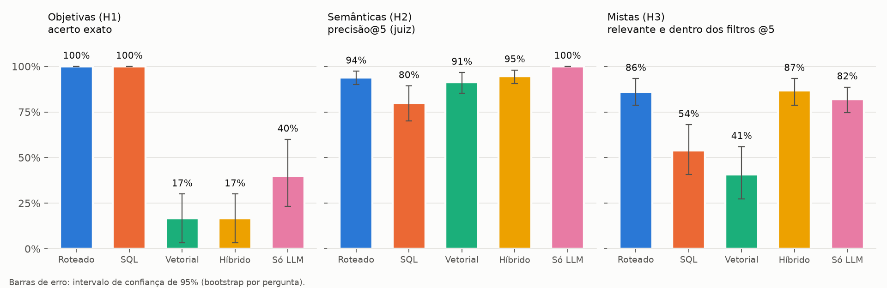
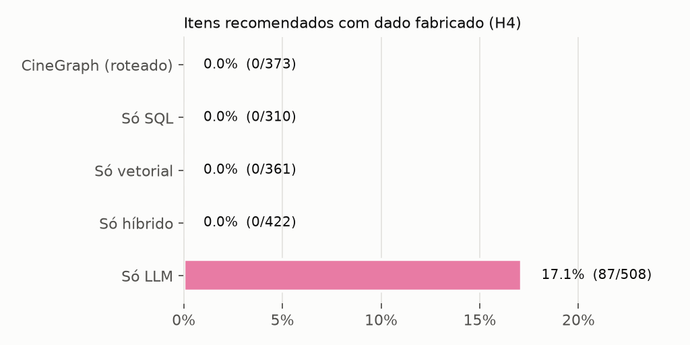
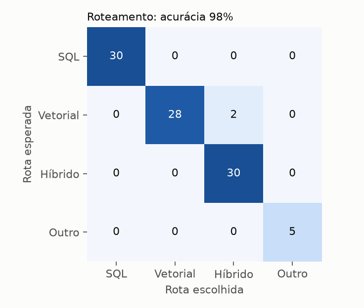

# Avaliação do CineGraph

Execução `20261117-173343` · 95 perguntas · modelo `claude-sonnet-5-5` · embeddings `paraphrase-multilingual-MiniLM-L12-v2` · prompts v2026-11-11.1 · custo total US$ 4.33

## Hipóteses do projeto

Testes pareados por pergunta (as configurações respondem às mesmas perguntas), α = 5%, p-valores também ajustados por Holm para as comparações múltiplas.

| Hipótese | Métrica | Resultado | Teste | Veredito |
|---|---|---|---|---|
| H1. SQL é mais preciso em filtros, contagens e rankings | acerto exato nas objetivas | SQL 100% · vetorial 17% · híbrido 17% | McNemar × Vetorial: p < 0,001 (Holm < 0,001); McNemar × Híbrido: p < 0,001 (Holm < 0,001) | confirmada |
| H2. Busca vetorial é mais relevante em tema e atmosfera | precisão@5 nas semânticas | vetorial 91% · SQL 80% | Wilcoxon × SQL: p = 0,058 (Holm = 0,058) | não confirmada (sem significância a 5%) |
| H3. Híbrido é melhor em perguntas mistas | relevante e dentro dos filtros @5 | híbrido 87% · SQL 54% · vetorial 41% | Wilcoxon × SQL: p < 0,001 (Holm < 0,001); Wilcoxon × Vetorial: p < 0,001 (Holm < 0,001) | confirmada |
| H4. Roteamento inventa menos que um chatbot só com LLM | itens com dado fabricado | roteado 0.0% · só LLM 17.1% | Fisher × Só LLM: p < 0,001 (Holm < 0,001) | confirmada |

Por pergunta: 43 das 90 respostas do só LLM têm algum item com dado errado; no roteado, 0 de 90.

**Roteado × melhor mecanismo forçado de cada categoria:** sql (SQL):100% × 100%, McNemar p = 1,000; semantic (Híbrido):94% × 95%, Wilcoxon p = 0,317; mixed (Híbrido):86% × 87%, Wilcoxon p = 0,317.

## Roteamento

Acurácia geral: **98%** (IC95% 95–100%, n=95). Por categoria: sql 100%, semantic 93%, mixed 100%, outro 100%.

| esperada \ escolhida | sql | vector | hybrid | outro |
|---|---|---|---|---|
| sql | 30 | 0 | 0 | 0 |
| vector | 0 | 28 | 2 | 0 |
| hybrid | 0 | 0 | 30 | 0 |
| outro | 0 | 0 | 0 | 5 |

Taxa de erro: 2.1%. Por rota, tratada como positiva contra as demais:

| rota | precisão | revocação | especificidade |
|---|---|---|---|
| sql | 100.0% | 100.0% | 100.0% |
| vector | 100.0% | 93.3% | 100.0% |
| hybrid | 93.8% | 100.0% | 96.9% |
| outro | 100.0% | 100.0% | 100.0% |
| média (macro) | 98.4% | 98.3% | 99.2% |

## Resultados por categoria

Valores médios com intervalo de confiança de 95% (bootstrap sobre as perguntas).

**Objetivas (30 perguntas com SQL de referência)**

| Configuração | Acerto exato | Precisão@k | SQL igual ao gabarito |
|---|---|---|---|
| CineGraph (roteado) | 100% (100–100) | 100% (100–100) | 100% (100–100) |
| Só SQL | 100% (100–100) | 100% (100–100) | 100% (100–100) |
| Só vetorial | 17% (3–30) | 18% (7–32) | — |
| Só híbrido | 17% (3–30) | 20% (8–35) | — |
| Só LLM | 40% (23–60) | 56% (41–71) | — |

**Semânticas (relevância dada pelo juiz)**

| Configuração | Precisão@5 | Relevância média |
|---|---|---|
| CineGraph (roteado) | 94% (90–97) | 78% (72–84) |
| Só SQL | 80% (70–89) | 67% (57–76) |
| Só vetorial | 91% (85–97) | 75% (68–81) |
| Só híbrido | 95% (91–98) | 78% (73–84) |
| Só LLM | 100% (100–100) | 93% (90–95) |

**Mistas (relevância + filtros conferidos no banco)**

| Configuração | Relevante e nos filtros @5 | Respeita filtros | Precisão@5 |
|---|---|---|---|
| CineGraph (roteado) | 86% (79–93) | 100% (100–100) | 86% (79–93) |
| Só SQL | 54% (41–68) | 90% (77–100) | 54% (41–68) |
| Só vetorial | 41% (27–56) | 64% (48–80) | 53% (40–67) |
| Só híbrido | 87% (79–93) | 100% (100–100) | 87% (79–93) |
| Só LLM | 82% (75–89) | 80% (73–86) | 99% (98–100) |

**Média ± desvio-padrão por pergunta**

| Configuração | Objetivas · acerto exato | Semânticas · precisão@5 | Mistas · relevante e nos filtros @5 |
|---|---|---|---|
| CineGraph (roteado) | 100 ± 0% | 94 ± 11% | 86 ± 21% |
| Só SQL | 100 ± 0% | 80 ± 28% | 54 ± 37% |
| Só vetorial | 17 ± 38% | 91 ± 15% | 41 ± 41% |
| Só híbrido | 17 ± 38% | 95 ± 10% | 87 ± 21% |
| Só LLM | 40 ± 50% | 100 ± 0% | 82 ± 21% |

## Alucinação, latência e custo

| Configuração | Dado fabricado | Título inexistente | Chega ao usuário | Latência p50 | p95 | US$/pergunta | Erros |
|---|---|---|---|---|---|---|---|
| CineGraph (roteado) | 0.0% (0/373) | 0.0% | 0.0% | 5.3 s | 7.4 s | 0.0090 | 0 |
| Só SQL | 0.0% (0/310) | 0.0% | 0.0% | 5.2 s | 6.9 s | 0.0076 | 0 |
| Só vetorial | 0.0% (0/361) | 0.0% | 0.0% | 2.9 s | 3.8 s | 0.0063 | 0 |
| Só híbrido | 0.0% (0/422) | 0.0% | 0.0% | 3.0 s | 3.8 s | 0.0065 | 0 |
| Só LLM | 17.1% (87/508) | 0.2% | 17.1% | 5.1 s | 7.0 s | 0.0062 | 0 |

No CineGraph, título, ano, gêneros e nota exibidos vêm do banco; o único dado que o modelo pode inventar é um ID fora dos candidatos, e esse ID é descartado antes de chegar ao usuário (coluna "Chega ao usuário").

## Método e limitações

- A rota e os filtros são extraídos uma vez por pergunta e reaproveitados nas configurações forçadas, que só trocam o mecanismo de recuperação.
- A busca vetorial da avaliação usa a cópia local dos vetores (busca exata por cosseno), para não gastar a cota diária de leituras do Firestore. O site usa o Firestore com os mesmos vetores.
- A relevância é dada por um juiz LLM (o mesmo modelo), que pode favorecer filmes famosos e as próprias escolhas. Vale revisar por amostragem.
- Com 30 perguntas por categoria, o poder estatístico é baixo: diferenças de cerca de 10 pontos podem não ser significativas a 5%.
- Não há treino (o LLM é usado sem ajuste fino), mas algumas perguntas do conjunto serviram para ajustar prompts e o índice durante o desenvolvimento; um conjunto de teste novo daria uma estimativa sem esse viés.
- O baseline "só LLM" é conferido contra o MovieLens: título, ano (±1), gêneros e nota média (±0,3).
